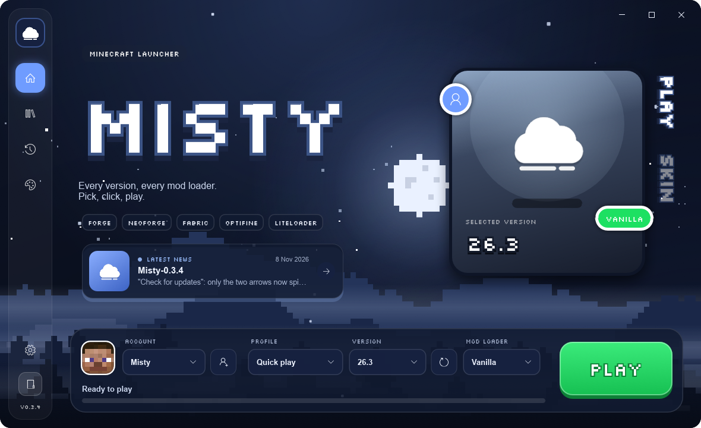

<div align="center">


# Misty Web

**The website of Misty, the Minecraft launcher light as the mist.**

Rendered server-side in Rust: pages, translations, patch notes and the pixel-art night scene.

[](https://misty-launcher.online/)
[](https://github.com/Misty-MC/Misty-Web/deployments)
[](https://www.rust-lang.org/)
[](https://github.com/tokio-rs/axum)
[](Dockerfile)
[](LICENSE)

[**Website**](https://misty-launcher.online/) · [**Docs**](https://misty-launcher.online/docs) · [**Patch notes**](https://misty-launcher.online/patch-notes) · [**Launcher**](https://github.com/Misty-MC/Misty) · [**Releases**](https://github.com/Misty-MC/Misty/releases)



</div>

## 🖼️ Launcher screenshots

The screenshots shown on the site live in `public/assets/screens/<lang>/` (`en` and `fr`, 1180 × 720): `home`, `profiles`, `textures` (site gallery) and `settings` (READMEs).
They are taken by the launcher itself (`MISTY_CAPTURE`, debug build), on a demo data folder (`MISTY_DATA_DIR`).

## 🗂️ Project structure

```
src/
├── main.rs            startup, routes, static files
├── routes.rs          pages, /docs, /shop, /api/latest, /download/*, /skin, /cape, /player
├── skins.rs           Minecraft profiles for the shop (Mojang API, mc-heads.net fallback)
├── seo.rs             JSON-LD, robots.txt, sitemap.xml
├── docs.rs            documentation pages (docs/<lang>/NN-slug.md)
├── github.rs          GitHub releases + cache
├── i18n.rs            language negotiation and translations
├── markdown.rs        Markdown → safe HTML (release notes and docs)
├── format.rs          localized dates and sizes
├── scene.rs           pixel-art night scene and fog (SVG)
└── views/             HTML pages (maud)
    ├── layout.rs      <head>, navigation, footer
    ├── home.rs        home page
    ├── patch_notes.rs patch notes
    ├── docs.rs        documentation
    ├── not_found.rs   404
    └── icons.rs       SVG icons
locales/               one TOML file per language
docs/                  documentation, one folder per language (en is the reference)
public/
├── css/               base, layout, home, patch-notes, docs
├── js/site.js         smooth scrolling, navigation, animations
└── assets/            icon, Silkscreen font, screenshots
```

## 📄 License

The code is released under the [MIT License](LICENSE).
The Silkscreen font is distributed under the [SIL Open Font License](public/assets/OFL.txt).
[skinview3d](https://github.com/bs-community/skinview3d) (3D skin preview in the shop) is bundled under the [MIT License](public/vendor/skinview3d/LICENSE).

---

<div align="center">
<sub>
Misty is an independent launcher and is not affiliated with Mojang Studios or Microsoft.<br/>
Minecraft is a trademark of Mojang AB.
</sub>
</div>
